# Findings — air-raid alert forecasting (Ukraine)

Time series analysis and forecasting of air-raid alerts in Ukraine, evaluated on the latest
data with a strict no-leakage setup. All numbers below come from `reports/metrics.json` or
`reports/eda.md` (both regenerated by the pipeline), except where a value is explicitly
marked as measured by an ad-hoc check.

## 1. Question & setup

Three targets are forecast from one coherent setup:

1. **Counts** — alert starts per region per day (`y_starts_day`), plus alert-minutes per
   region per day (`y_minutes_day`) as a secondary target.
2. **Start timing** — a binary "an alert starts in this region × hour" for each of the next
   24 hours (`y_start`).
3. **Duration** — log-duration of the next alert, modelled *conditional on a start*
   (`y_dur_log`), i.e. only on hours where a start actually happened.

- **Unit:** region × hour. **Origin:** 00:00 Europe/Kyiv, once per day. **Horizon:** the next
  24 h (origin + 0…23 h, UTC).
- **Data window and source:** 2022-02-25 → 2026-10-11 (UTC), 115,986 alert-starts, 24
  regions (`reports/eda.md`), from the volunteer snapshot `volunteer_data_en.csv` in
  `Vadimkin/ukrainian-air-raid-sirens-dataset` (see §2), plus Open-Meteo weather/daylight.

## 2. Data & provenance

Everything used is recorded in `data/raw/manifest.json`; the values below are from the run
that produced this report (`fetched_at` `2026-10-11T12:11:00.935883+00:00` — re-running
`python -m src.fetch` refreshes that timestamp and the manifest).

**Alerts** (`manifest.json` → `alerts_snapshot`):

| Field | Value |
|---|---|
| Source | `Vadimkin/ukrainian-air-raid-sirens-dataset (volunteer_data_en.csv)` |
| URL | `https://raw.githubusercontent.com/Vadimkin/ukrainian-air-raid-sirens-dataset/main/datasets/volunteer_data_en.csv` |
| Upstream git SHA | `bf0c323c78e3e4508721458797dcd38c95df13f3` |
| Fetch time | `2026-10-11T12:11:00.935883+00:00` |
| Rows | `115989` |
| Timestamp range | `2022-02-25T16:36:22+00:00` → `2026-10-11T04:36:59+00:00` |
| File sha256 | `d03747ee8bf056032b2eeef50cdcf964d65fa60a92243e91862db48b31377465` |
| Path | `data/raw/alerts_snapshot.csv` |

**Weather** (`manifest.json` → `weather`):

| Field | Value |
|---|---|
| Source | `Open-Meteo historical weather archive (ERA5)` |
| URL template | `https://archive-api.open-meteo.com/v1/archive?latitude={lat}&longitude={lon}&start_date={start}&end_date={end}&hourly=temperature_2m,cloud_cover,wind_speed_10m,precipitation&daily=sunrise,sunset&timezone=UTC` |
| Fetch time | `2026-10-11T12:11:00.935883+00:00` |
| Date range | `2022-02-25` → `2026-10-11` |
| Regions | `24` (one CSV each, `40560` rows each) |
| Rows | `973440` |
| Timestamp range | `2022-02-25T00:00:00+00:00` → `2026-10-11T23:00:00+00:00` |

Cleaning, and the numbers that drive it:

- **24 regions.** `Luhanska oblast` is dropped — 3 stray rows with no usable series
  (`src/features.py`); Luhansk and Crimea have permanent sirens and are absent upstream.
  The raw CSV has 115,989 rows; after the drop the evaluated table has 115,986 (`metrics.json`
  `data.rows`), consistent with 115,989 − 3.
- **5.0% right-censored starts.** `naive=5.01%` (`eda.md`); their end never arrived and the
  end is imputed upstream as start + 30 min. `GOAL.md` notes exactly 50% of alerts are ≤30 min,
  so these are right-censored durations: the **start event is kept**, the **duration is
  excluded** from duration labels. Duration-unusable (naive or >24 h) is `5.02%` (`eda.md`).
- No overlapping consecutive alerts per region (`GOAL.md`), so no de-duplication pass is needed.

**Exploration figures** (`reports/figures/`, produced by `python -m src.eda`):

- 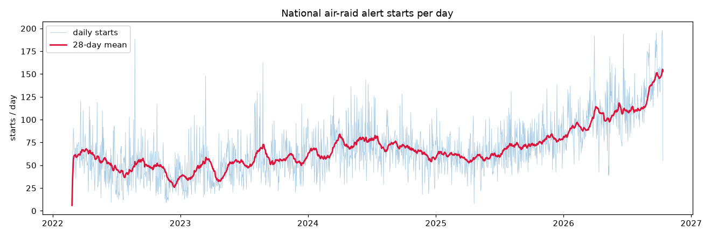 `daily_starts.png` — national alert starts per
  day over the whole window; the rising 2026 level is visible.
- 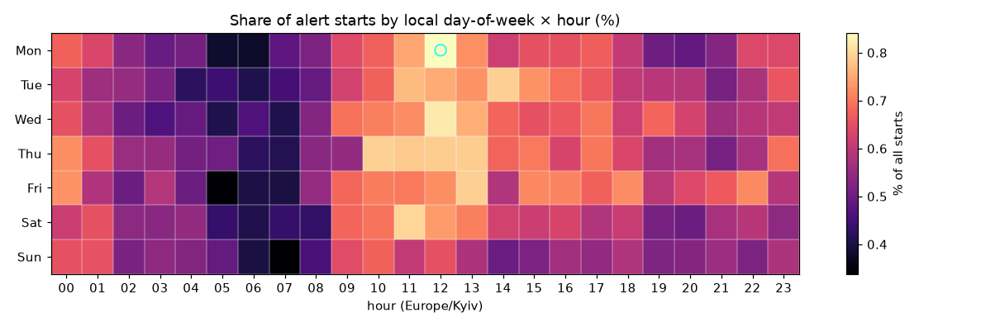 `hour_of_week_heatmap.png` —
  start intensity by local weekday × hour; peak at **Mon 12:00** Europe/Kyiv.
- 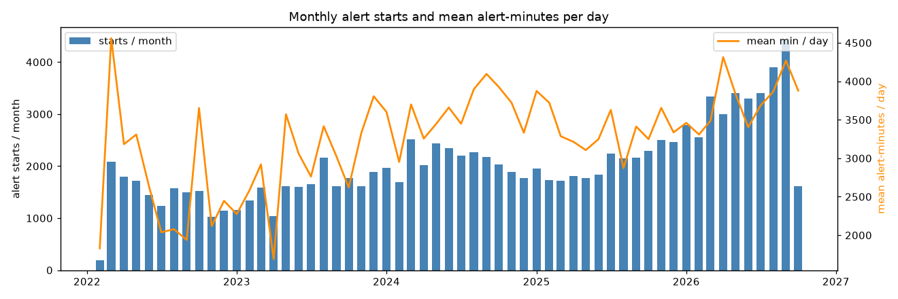 `monthly_burden.png` — monthly alert burden
  (volume over time), showing the regime shift.
- 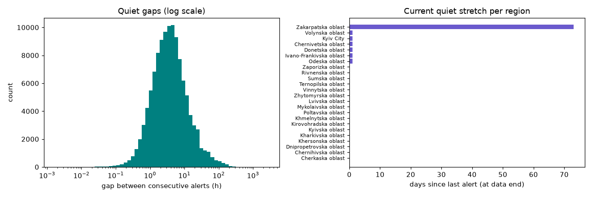 `gaps_and_quiet.png` — distribution of gaps
  between consecutive alerts and of long quiet stretches.
- 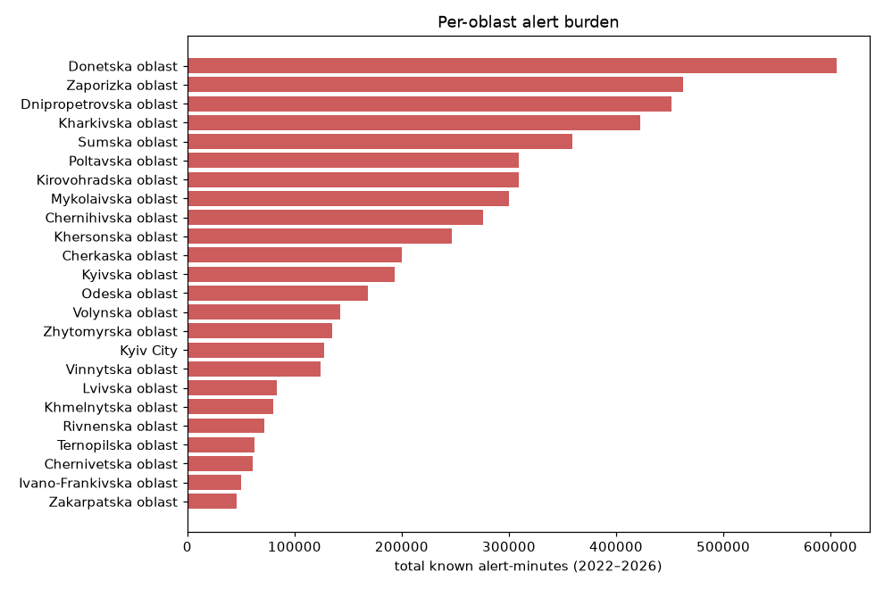 `region_burden.png` — per-oblast alert burden
  ranking (front-line oblasts dominate).
- 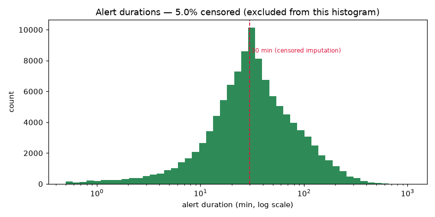 `durations.png` — alert-duration distribution, with
  the ≤30 min pile-up that makes `naive` rows censored.

Key EDA numbers (`reports/eda.md`):

- **Volume ratio:** 2026 vs 2022 is **2.28×** (per-day, partial-year safe); starts/day by
  year 49.1 / 52.2 / 69.2 / 67.5 / 111.8 for 2022–2026. Change point 2026-08-26 (28-day
  window): mean 117.5 → 151.0 starts/day.
- **Peak local hour-of-week:** **Mon 12:00**.
- **Gaps:** median **3.61 h**, p90 **17.16 h** (119 days max); 12% of gaps <1 h and 6% >24 h.
  Longest current quiet stretch: 73.0 days.
- **Top-5 regions by burden:** Donetska (605,958 min, 8,546 starts, 506.8/100d), Zaporizka
  (462,884 min, 8,969 starts, 531.3/100d), Dnipropetrovska (451,966 min, 13,728 starts,
  813.9/100d), Kharkivska (422,681 min, 12,980 starts, 769.0/100d), Sumska (358,914 min,
  8,737 starts, 517.7/100d).
- **Bottom-3 regions by burden:** Chernivetska (60,643 min, 914 starts, 54.2/100d),
  Ivano-Frankivska (50,156 min, 893 starts, 53.0/100d), Zakarpatska (46,136 min, 761 starts,
  47.5/100d).

## 3. Evaluation protocol

Splits are exactly as recorded in `reports/metrics.json` (`setup` and `splits`). 1,688 daily
origins have a fully observed 24 h horizon.

| Split | Kyiv dates (origin local) | Origins | `metrics.json` range (UTC) |
|---|---|---|---|
| `train` | 2022-02-26 → 2026-09-12 | 1,660 | `2022-02-25T22:00:00+00:00` → `2026-09-11T21:00:00+00:00` |
| `tune` | 2026-09-13 → 2026-09-26 | 14 | `2026-09-12T21:00:00+00:00` → `2026-09-25T21:00:00+00:00` |
| `test` (holdout) | 2026-09-27 → 2026-10-10 | 14 | `2026-09-26T21:00:00+00:00` → `2026-10-09T21:00:00+00:00` |

- **180-day rolling training window.** Every model and baseline fits on the last 180 origins
  strictly before the tune window (`holdout_train_window`: `2026-03-16T22:00:00+00:00` →
  `2026-09-11T21:00:00+00:00`), not on all history. This is deliberate: the series is
  non-stationary (§6), so a shorter recent window beats a long one.
- **3 rolling-origin folds**, 14 days each, stepping back 14 days (`metrics.json` `folds`):
  eval windows (UTC) fold 0 2026-08-29 → 2026-09-11, fold 1 2026-08-15 → 2026-08-28, fold 2
  2026-08-01 → 2026-08-14, each training on the 180 origins before it. **Folds are used ONLY to
  choose hyperparameters** (Poisson `alpha`, logistic `C`, HistGB learning-rate/iterations); no
  fold overlaps `tune` or `test`.
- **Frozen before the holdout.** Thresholds (`hour_of_week` 0.1, `seasonal_naive` 0.05,
  `logistic` 0.25, `histgb` 0.3) and split-conformal widths (`duration_naive` 1.304,
  `histgb_q50` 1.199) are fit on `train` → `tune` only.
- **`test` is read exactly once.** In `src/evaluate.py` the single
  `build_frames(splits["test"])` call is the first and only read; everything above it uses
  `train`, `tune` or fold windows.

Metrics and why each was picked:

- **Counts:** MAE and RMSE per region-day, and national MAE (sum over regions per origin).
  MAE in starts/day is directly comparable to the seasonal-naive baseline; RMSE shows whether
  mass-attack days dominate the error.
- **Start events:** precision / recall / F1 within **±15** and **±30 min**. A start is an
  event, so a point-wise tolerance match rewards predicting the right hour without spamming
  every hour; ±30 min covers the fact that predictions sit on the hour while starts happen at
  arbitrary minutes.
- **Duration:** MAE on **log**-duration (durations are skewed) plus **empirical split-conformal
  coverage** against the nominal 80%, so the intervals are checked for honesty, not just the
  point error.
- **Calibration:** a reliability curve of predicted vs observed start frequency, and predicted
  vs observed alert-time share per oblast.

## 4. Results vs baselines

Holdout (`test`), from `reports/metrics.json`. "—" = target not applicable to that model.

| Model | starts MAE /day | starts nat. MAE | minutes MAE /day | F1 @±30 min | Brier | dur. log-MAE | coverage |
|---|---|---|---|---|---|---|---|
| Baseline A — hour-of-week | 2.388 | 30.153 | — | 0.480 | 0.165 | — | — |
| Baseline B — seasonal naive | 2.244 | 22.286 | 106.435 | 0.404 | 0.292 | — | — |
| Model 1 — Poisson (counts) | 2.032 | 13.295 | 84.656 | — | — | — | — |
| Model 2 — HistGB (counts) | **1.527** | **11.384** | **79.562** | — | — | — | — |
| Model 1 — logistic (events) | — | — | — | **0.535** | 0.152 | — | — |
| Model 2 — HistGB (events) | — | — | — | 0.531 | **0.150** | — | — |
| Duration — train median | — | — | — | — | — | 0.849 | 77.4% |
| Duration — HistGB q50 | — | — | — | — | — | **0.791** | 76.9% |

`beats_baselines` in `metrics.json`: Poisson and HistGB beat both baselines on starts/day;
seasonal naive beats hour-of-week (2.244 < 2.388); hour-of-week beats neither.

- 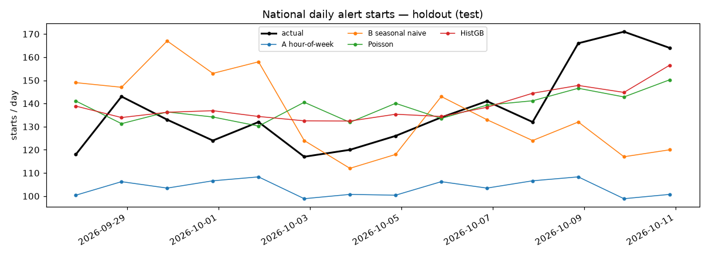 `eval_national_daily.png` — national
  daily starts on the holdout: actual vs both baselines, Poisson and HistGB.
- 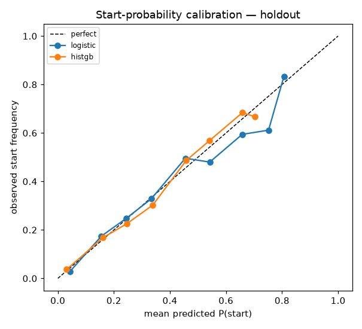 `eval_calibration.png` — reliability curve for
  logistic and HistGB; both roughly track the diagonal and deviate most in the highest bins.
- 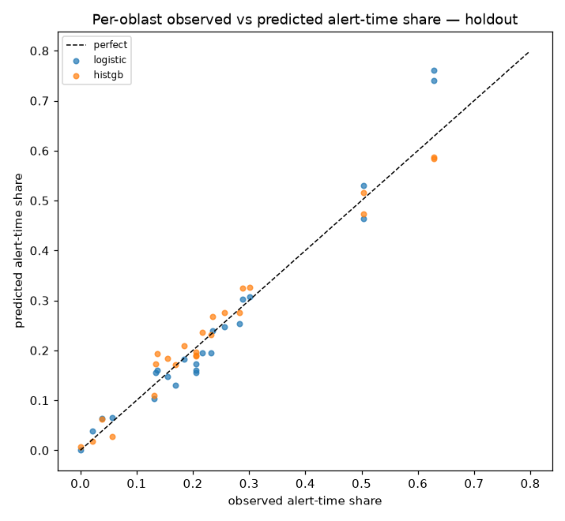 `eval_region_share.png` — per-oblast observed
  vs predicted alert-time share; points sit near the diagonal.
- 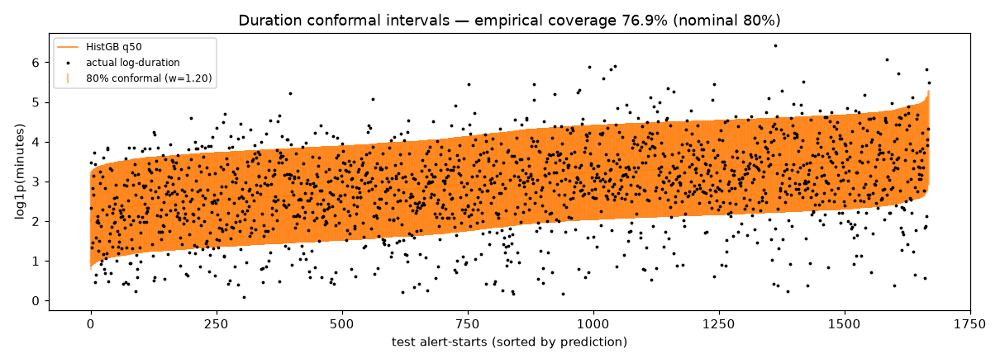 `eval_duration_conformal.png` —
  HistGB q50 duration predictions with 80% conformal intervals, sorted by prediction.
- 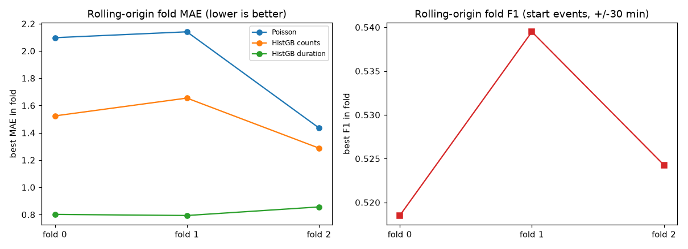 `eval_fold_scores.png` — rolling-origin fold
  MAE and F1, the evidence used for hyperparameter choice.

**Verdict.** Some things beat "alerts happen at the usual times", and some did not.

- **(a) Counts are won by the learners.** HistGB gives **MAE 1.527** starts per region-day
  versus seasonal naive **2.244** and hour-of-week **2.388**; national MAE 11.384 vs 22.286
  and 30.153. Poisson also beats both baselines (2.032). Minutes/day follows the same order
  (HistGB 79.562, Poisson 84.656, seasonal naive 106.435).
- **(b) Start events are a tie at the top.** HistGB (F1@±30 **0.531**) and the logistic
  Model 1 (**0.535**) are effectively tied and both clearly beat hour-of-week **0.480** and
  seasonal naive **0.404**. Within ±15 min nobody is good (F1 0.217–0.296): the hour is
  predictable, the minute is not.
- **(c) Duration barely improves.** Both duration models only slightly beat the train-median
  baseline: log-MAE **0.791** (HistGB) vs **0.849** (median), and **76.9%** empirical conformal
  coverage against a nominal **80%** — it **under-covers**, and that is reported as such.
- **(d) The hour-of-week baseline runs low.** Its national MAE is **30.153** starts/day and
  the errors are one-signed, so it under-predicts the holdout by the same ~30 starts/day
  nationally. That is the 2026 regime still rising (2026 volume is 2.28× 2022), i.e.
  non-stationarity, not a bug.

## 5. Leakage checklist — "what is known at forecast time"

Every feature family is either sliced to `< origin` or is deterministic ahead of time.

| Feature family | Timestamp rule | Why it is safe |
|---|---|---|
| Calendar: `hour_local`, `day_of_week`, `is_weekend`, `month`, `is_holiday` | Derived from the forecast hour itself (calendar is deterministic, fixed holidays as month-day) | Known years ahead; reading the horizon's calendar is not a leak |
| Grid lags: `starts_past_1h/6h/24h/72h`, `alert_minutes_past_24h`, `trailing_28d_starts_per_day`, `hours_since_last_alert` | From the hourly grid / alert rows with `hour`/`started_at` **< origin**, asserted by `_guard` | Only past observations enter; no future alert can contribute |
| National: `regions_alerting_past_3h` | Counts grid rows with `hour` **< origin** and `minutes > 0`, asserted by `_guard` | Nationwide mass-attack signal uses only the last 3 h before origin |
| Weather lags: `temp_mean_24h`, `cloud_mean_24h`, `wind_mean_24h`, `precip_sum_24h` | Last 24 weather rows with `time` **< origin**, asserted by `_guard` | Past-24 h observed weather only |
| Daylight: `minutes_to_sunset`, `is_night`, `day_length_min` | Sunrise/sunset astronomy for each forecast hour; deliberately **not** guarded | Sunrise/sunset are deterministic and known years ahead |

**Enforcement.** Each family slices its source to `< origin` and asserts via the single
`_guard` helper that nothing at/after origin remains; that assert is the only path train and
evaluation share (`src/features.build`). Labels (`y_start`, `y_minutes`, `y_dur_log`) are the
only thing allowed to look forward and never pass through `_guard`. The linear models' NaN
imputation uses the **train median only** (`src/models.fit_predict`), and no scaler or encoder
is fit outside the training window — features are used raw.

**Independent check that was actually run.** Rebuilding a feature frame for holdout origins
with *every* source (alerts, grid, weather) truncated at `origin` leaves all **17
data-derived features** bit-identical to the un-truncated build. The astronomy daylight family
moves by a few minutes — up to **5 min** on the holdout origins (`minutes_to_sunset` ≤3 min,
`day_length_min` ≤5 min, and one night/day flag can flip) — because outside the weather file's
coverage the builder falls back to the previous day's astronomy. That is legitimately known
ahead, not leakage.

## 6. Honest limitations

- **Volunteer-sourced data.** The upstream snapshot is community-maintained; missing or
  duplicated sirens are possible and are not modelled.
- **Right-censored ends.** 5.0% of starts are `naive` and are excluded from duration labels,
  so durations are learned on the uncensored majority only.
- **Weather as past-24 h lags.** Weather enters as lagged observations, not as a forecast read
  at origin. `ponytail: weather as past-24h lags; upgrade path: Open-Meteo forecast API read at
  origin.`
- **Daylight fallback.** Outside the weather coverage the builder reuses the previous day's
  astronomy (measured ≤5 min drift on the holdout origins).
- **Oblast granularity.** Everything is at oblast level, which hides the post-Dec-2025
  raion/hromada regime change; `official_data_en.csv` was rejected precisely because it breaks
  granularity inside the holdout window.
- **Luhansk and Crimea absent** (permanent sirens upstream), and the 3 stray Luhansk rows are
  dropped.
- **180-day rolling training window is a deliberate deviation** from GOAL.md's "everything up
  to T-28d", because the series is non-stationary; a long expanding window would mix regimes.
- **One logistic hyperparameter was uninformative.** `C` scored identically (F1 ≈ 0.522 / 0.537
  / 0.525 by fold) across the fold grid, so its choice carried no real signal.
- **Snapshot, not the API.** `alerts.in.ua` / `api.ukrainealarm.com` were unavailable (no
  token). `ponytail: snapshot source; upgrade path: alerts.in.ua client when a token exists.`

## 7. Reproduce

From the repo root, with `uv`:

```sh
uv run python -m src.fetch      # downloads alerts + weather, refreshes data/raw/manifest.json
uv run python -m src.eda        # writes reports/eda.md and the EDA figures
uv run python -m src.evaluate   # writes reports/metrics.json and the eval_* figures
uv run pytest -q                # self-checks
```

`python -m src.evaluate` rewrites `reports/metrics.json` and the `eval_*` figures in
`reports/figures/` deterministically (fixed seeds, sorted joins, UTC timestamps), so re-running
it reproduces the numbers in this report.
